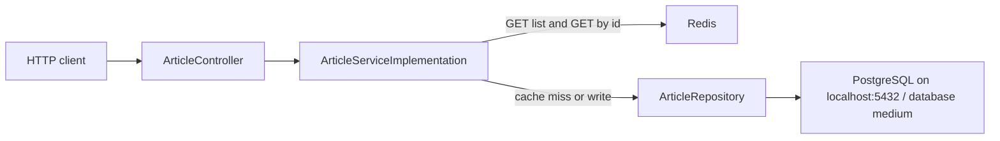

# Medium Articles API

Spring Boot API that stores and reads Medium-style article records in PostgreSQL, with Redis in front of the two read paths.

An article has a URL, title, subtitle, opening paragraph, image name, clap count, response count, reading time, publication name, and publication date. The HTTP API creates, lists, fetches, updates, and deletes those rows. List and single-article reads are cached in Redis.

## Tech stack

| Piece | What the repo pins | Where |
| --- | --- | --- |
| Language | Java 21 | `pom.xml` (`java.version`), `Dockerfile` (`openjdk:21`) |
| Framework | Spring Boot 3.2.5 | `pom.xml` parent |
| HTTP | `spring-boot-starter-web` | `pom.xml` |
| Persistence | Spring Data JPA, Hibernate, `ddl-auto: none`, database `postgresql` | `pom.xml`, `application.yaml` |
| JDBC driver | `org.postgresql:postgresql` (version managed by Spring Boot) | `pom.xml` |
| Validation | `spring-boot-starter-validation` (Jakarta Bean Validation) | `pom.xml` |
| Cache | `spring-boot-starter-data-redis`, `spring.cache.type: redis` | `pom.xml`, `application.yaml` |
| Health | `spring-boot-starter-actuator` (web exposure left at the Boot default, `health`) | `pom.xml` |
| Boilerplate | Lombok, `provided` scope, used by the Redis classes | `pom.xml` |
| Local database | `postgres:16.2` | `docker-compose-db.yaml` |
| Local cache | `redis:7.2.4` | `docker-compose-db.yaml` |

`pom.xml` also sets the property `spring-cloud-gcp.version` to `5.1.2`. No dependency uses that property, and the POM does not import Spring Cloud GCP.

The listened port is Spring Boot's default, **8080**. `application.yaml` does not set `server.port`. The `Dockerfile` exposes 8080.

## Architecture



`MediumArticlesApplication` turns on `@EnableCaching`. The only repository is `ArticleRepository`, a `JpaRepository` for `Article`. Every read and every write goes through that one bean and the single datasource in `src/main/resources/application.yaml`:

```yaml
datasource:
  url: jdbc:postgresql://localhost:5432/medium
  username: postgres
  password: <value in application.yaml>
  driver-class-name: org.postgresql.Driver
```

`spring.jpa.hibernate.ddl-auto` is `none`, so Hibernate will not create the `articles` table. The SQL script has to be applied first.

### What Redis is for

Two read methods are `@Cacheable`:

| Cache name | Method | What is stored |
| --- | --- | --- |
| `article-list` | `getAllArticlesFromDB(page)` | One page of articles. The cache key is the page number. Each page is 25 rows, sorted by `id` ascending. |
| `article-single` | `getArticleFromDB(id)` | One article. The cache key is the id. |

A repeated `GET` for the same page or the same id is served from Redis and does not query PostgreSQL until that entry is removed.

Cache removal in this code:

- `DELETE /medium/api/v1/articles/{id}` evicts the `article-single` entry for that id. It leaves `article-list` in place.
- `POST` and `PUT` do not evict either cache. A list or a single-article `GET` can keep returning the previous Redis value after a create or an update.
- `RedisCacheCleaner` clears both caches on a `fixedDelay` of one hour (the next run starts one hour after the previous run finishes).
- `GET /medium/api/v1/articles/clearcache` clears both caches immediately.

### Local containers versus the process that actually runs

`docker-compose-db.yaml` starts three containers:

| Compose service | Image | Container name | Published port |
| --- | --- | --- | --- |
| `postgres` | `postgres:16.2` | `postgres-master` | `5432` |
| `replica` | `postgres:16.2` | `postgres-replica` | `5433` |
| `redis` | `redis:7.2.4` | `redis-cache` | `6379` |

The application configuration uses the primary on port 5432 and Redis on port 6379. The second Postgres container is a separate server: the compose file does not set replication settings (`primary_conninfo`, a replication slot, or `wal_level`). No Java class opens a second `DataSource`.

`src/main/resources/architecture/application.multidatasources.yaml` sketches `datasource1` for writes and `datasource2` for reads, with hosts taken from environment variables. Spring Boot loads `application.yaml` only. That sample file is not an active profile.

## Database

The running configuration is a PostgreSQL JDBC URL, the `org.postgresql` driver, and a database named `medium`. Locally that server is the `postgres:16.2` image in `docker-compose-db.yaml`.

<!--
TODO: Cloud SQL or AlloyDB? The GitHub repository description says the database is Cloud SQL for PostgreSQL and that the API runs on Cloud Run. The previous README said AlloyDB in high-availability mode with one read replica, Memorystore for Redis, and Cloud Run, in a region it called WEST1. The drawing at src/main/resources/architecture/medium-articles-api.drawio (and the exported jpg next to it) labels AlloyDB master / replica / slave, Memorystore, Artifact Registry, and Identity Aware Proxy inside a box marked US-WEST1. None of those product names, and no GCP region, appear in application.yaml, the Maven dependencies, the Dockerfile, or docker-compose-db.yaml. The code does not include a Cloud SQL connector or an AlloyDB connector, so it does not "support" either product. Confirm the instance that was actually provisioned before describing a cloud deployment. Do not invent a region: WEST1 is not a Google Cloud region id.
-->

The table is created by `src/main/resources/postgres/medium.sql`. The JPA entity `Article` maps `id` to the primary key `id_article`. The script also creates a `varchar(20)` column named `id`, plus an index on it. The entity does not map that column, and the API never reads or writes it.

| Column | SQL | API field |
| --- | --- | --- |
| `id_article` | `bigserial` primary key | `id` |
| `id` | `varchar(20)`, indexed | not mapped |
| `url` | `text` | `url` |
| `title` | `text` | `title` |
| `subtitle` | `text` | `subtitle` |
| `first_para` | `text` | `firstPara` |
| `image` | `varchar(20)` | `image` |
| `claps` | `double precision`, check `>= 0` | `claps` |
| `responses` | `double precision`, check `>= 0` | `responses` |
| `reading_time` | `double precision`, check `>= 0` | `readingTime` |
| `publication` | `varchar(150)` | `publication` |
| `date` | `date` | `date` (`yyyy-MM-dd`) |

The script ends with `alter table articles owner to postgres`.

## Run locally

You need JDK 21 and Docker Compose v2. `JAVA_HOME` must point at the JDK. The repository includes `mvnw` (Maven Wrapper 3.2.0), and `.gitignore` ignores `.mvn/`. That directory is not in the tree, so the wrapper cannot read `.mvn/wrapper/maven-wrapper.properties` and `./mvnw spring-boot:run` fails as the repo is checked out. Use a local Maven 3.6.3 or newer (the minimum Spring Boot 3.2 accepts):

```bash
mvn spring-boot:run
```

### 1. Environment file for Compose

`docker-compose-db.yaml` interpolates variables and defines no defaults. `.gitignore` lists `docker-compose-db.env`, and that file is not committed. Compose reads a `.env` file in the project directory automatically. To use the gitignored name, pass `--env-file`.

The primary container's static address is `${DABASE_HOST}`. That spelling is the one in the compose file.

Create three empty directories for the bind mounts and put their **absolute** paths in the volume variables. The compose file uses the local volume driver with `type: none` and `o: bind`, so each directory has to exist before `up`.

```bash
# docker-compose-db.env
DATABASE_USERNAME=postgres
DATABASE_PASSWORD=<spring.datasource.password from src/main/resources/application.yaml>
DABASE_HOST=172.16.1.2
REPLICA_USERNAME=postgres
REPLICA_PASSWORD=<same password>
REPLICA_HOST=172.16.1.5
REDIS_HOST=172.16.0.4
VOLUME_POSTGRES=<absolute path>
VOLUME_REPLICA=<absolute path>
VOLUME_REDIS=<absolute path>
GATEWAY_HOST=172.16.0.1
SUBNET_CIDR=172.16.0.0/16
```

`DATABASE_USERNAME` has to be `postgres` so it matches `application.yaml` and the `OWNER TO postgres` statement in the SQL script. `DATABASE_PASSWORD` has to match `spring.datasource.password` in that same file. The three host addresses above are a local example: they sit inside `172.16.0.0/16` and they are distinct from the gateway. They are Docker bridge addresses for this compose network.

`application.yaml` connects to `localhost:5432` and Redis on `localhost:6379`. The published host ports in the compose file are what make that work. Redis in this compose file has no password, and `application.yaml` sets none.

### 2. Start Postgres and Redis

```bash
docker compose --env-file docker-compose-db.env -f docker-compose-db.yaml up
```

### 3. Create the database and the table

The compose file does not set `POSTGRES_DB`, so the image's default database is the name of `POSTGRES_USER` (`postgres`). The script's first line is `create database medium;`. A `psql` session stays on the database it opened, so apply that statement and the table DDL as two steps. Skip the first line on the second step.

```bash
docker exec -i postgres-master psql -U postgres -c "CREATE DATABASE medium;"
docker exec -i postgres-master psql -U postgres -d medium \
  -c "$(tail -n +2 src/main/resources/postgres/medium.sql)"
```

### 4. Start the API

```bash
mvn spring-boot:run
```

Then call `http://localhost:8080/medium/api/v1/articles?page=0`. With an empty table the response is HTTP 200, the header `Status: EMPTY`, and the text `There are no articles to show at this moment.`

A sample create body is in `src/main/resources/postgres/post_requestt.json` (the filename has two `t`s):

```bash
curl -s -D - -X POST http://localhost:8080/medium/api/v1/articles \
  -H 'Content-Type: application/json' \
  -d @src/main/resources/postgres/post_requestt.json
```

`spring.profiles.active` is `postgres`. There is no `application-postgres.yaml`, so that profile name does not change the configuration.

### Container image

The `Dockerfile` expects a jar that is already built at `target/medium-articles-0.0.1-SNAPSHOT.jar` (`groupId` `cloud.bigfito`, `artifactId` `medium-articles`).

```bash
mvn -DskipTests package
docker build -t medium-articles-api .
```

There are no test sources in the repository. The image's entrypoint is `java -jar /app.jar`. The `Dockerfile` declares `DATABASE_*`, `REPLICA_*`, and `REDIS_*` environment variables. `application.yaml` does not read them, so a container started from this image still uses `localhost` for PostgreSQL and Redis. One of those variables is spelled `REPLICAE_PORT` in the `Dockerfile`.

`GET /actuator/health` is available because `spring-boot-starter-actuator` is on the classpath and `management.endpoints.web.exposure.include` is left at the Spring Boot default (`health`).

## API

Base path: `/medium/api/v1`. Responses set a `Status` header along with the HTTP status.

| Method | Path | Success | Other results |
| --- | --- | --- | --- |
| `GET` | `/articles?page={n}` | **200**, header `Status: OK`, JSON array. `page` defaults to `0`. Page size is 25, ordered by `id` ascending. | Empty page: **200**, header `Status: EMPTY`, plain text. Non-integer `page`: **400**. Negative `page`: **400** JSON body from `ArticleExceptionHandler`. Database unreachable: **503**, plain text `The API is not AVAILABLE at this moment.` |
| `GET` | `/articles/{id}` | **200**, header `Status: FOUND`, one article. `id` is a positive integer (`id_article`). | Missing row: **404**, header `Status: NOT_FOUND`. Non-integer `id`: **400**. `id` less than 1: **400** JSON. Database unreachable: **503**. |
| `POST` | `/articles` | **201**, header `Status: CREATED`, the saved article including the generated `id`. | URL already stored: **302**, header `Status: FOUND`, and the request body is returned. The row is not inserted again. Invalid body: **400**, plain text `Check parameters in the BODY REQUEST.` Database unreachable: **503**. |
| `PUT` | `/articles` | **200**, header `Status: UPDATED`, the article from the request body. | Unknown `id`: **404**, header `Status: NOT_FOUND`. Invalid body: **400**. Database unreachable: **503**. |
| `DELETE` | `/articles/{id}` | **200**, header `Status: DELETED`, plain text `Article has been removed.` Also evicts the `article-single` cache entry for that id. | Missing row: **404**. Non-integer `id`: **400**. `id` less than 1: **400** JSON. Database unreachable: **503**. |
| `GET` | `/articles/clearcache` | **200**, plain text `REDIS CACHE cleared.` Clears `article-list` and `article-single`. | |

`GET /articles/clearcache` is a literal path on `RedisCacheController`. It is separate from `GET /articles/{id}`.

### Create body

`POST` deserializes `ArticleDTO`. Bean validation:

| Field | Rule |
| --- | --- |
| `url` | required, must be a URL |
| `title`, `subtitle`, `firstPara` | required, not blank |
| `image` | required, not blank, at most 20 characters |
| `claps`, `responses`, `readingTime` | required, zero or positive |
| `publication` | required, not blank, at most 150 characters |
| `date` | required, ISO-8601 date |

```json
{
  "url": "https://bigfito.cloud",
  "title": "Getting Started With Bigfito",
  "subtitle": "A Simple Tutorial for the Frustrated and Confused",
  "firstPara": "Hello world bigfito!",
  "image": "2024_04_20_0.jpg",
  "claps": 3300,
  "responses": 14,
  "readingTime": 8,
  "publication": "Towards Data Science",
  "date": "2024-04-20"
}
```

### Update body

`PUT` deserializes the `Article` entity, so the body includes `id` (`id_article`). `claps`, `responses`, and `readingTime` are `@Positive` on this type: zero is rejected here, while `POST` and the SQL checks allow zero. `id` itself must be a positive number.

### Errors

`ArticleExceptionHandler` handles three exception types thrown from the controllers:

| Exception | HTTP status | Body |
| --- | --- | --- |
| `BadArgumentException` | 400 | JSON: `timestamp`, `status`, `path`, `description` |
| `QueryExecutionException` | 500 | same JSON shape |
| `DatabaseConnectionException` | 503 | same JSON shape |

Most database-down paths in `ArticleController` catch `CannotCreateTransactionException` themselves and return **503** with a plain string, rather than `DatabaseConnectionException`.

## Google Cloud

This repository does not define Google Cloud resources. There is no project id, region, Cloud Run service, Memorystore instance, Cloud SQL instance, or AlloyDB cluster in the config, and there is no script that creates or deletes them.

<!--
TODO: Document approximate cost and the commands to tear the cloud resources down after the real project, database product, and region are confirmed. Those values are not in this repository, so they are not listed here.
-->

## Project layout

```
Dockerfile                  Image build. Expects the Maven jar already in target/.
docker-compose-db.yaml      Local Postgres primary, second Postgres container, Redis.
pom.xml                     Spring Boot 3.2.5, Java 21.
mvnw, mvnw.cmd              Maven Wrapper scripts. The .mvn/ directory is not committed.
src/main/java/cloud/bigfito/mediumarticles/
  MediumArticlesApplication.java
  controller/ArticleController.java
  service/ArticleService.java
  service/implementation/ArticleServiceImplementation.java
  repository/ArticleRepository.java
  entity/Article.java
  dto/ArticleDTO.java
  redis/RedisCacheController.java
  redis/RedisCacheCleaner.java
  exception/ArticleExceptionHandler.java
src/main/resources/application.yaml
src/main/resources/postgres/medium.sql
src/main/resources/postgres/post_requestt.json
src/main/resources/architecture/   Drawing and an unwired two-datasource sample.
LICENSE                     MIT, Copyright (c) 2026 Adolfo Orozco.
```

## License

MIT. See [LICENSE](LICENSE). Copyright (c) 2026 Adolfo Orozco.
